# Casa inteligente integral — Sistema domótico IoT

Proyecto integrador de **Arquitectura de Computadoras (ACO941)** · Universidad Don Bosco · Ciclo 02-2026 · **Fase 4: implementación y despliegue**.

Sistema domótico centralizado que monitorea sensores y controla actuadores en tiempo real mediante **MQTT**, con un **dashboard web** y un histórico en **Grafana**, alojados en un servidor Linux propio (máquina virtual con Docker). El circuito del ESP32 se simula completamente en **Wokwi** (sin hardware físico).

## Arquitectura

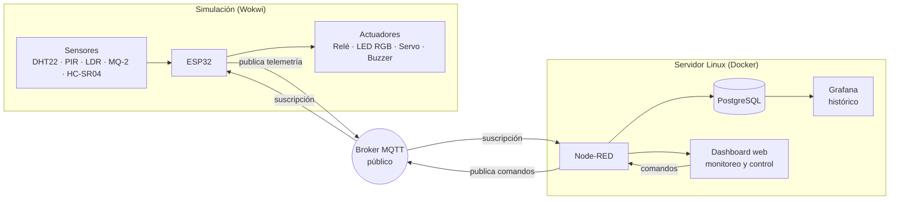

Flujo de datos:

1. El ESP32 lee los sensores cada 5 s y publica un mensaje JSON por variable (`<prefijo>/sensores/<nombre>`).
2. Node-RED, suscrito al broker, guarda las lecturas en PostgreSQL, evalúa las alarmas y actualiza el dashboard.
3. Desde el dashboard el usuario envía un comando (`<prefijo>/actuadores/<nombre>`); el ESP32, suscrito a esos topics, lo ejecuta y **confirma** su estado en `<prefijo>/estado/<nombre>`.
4. Grafana consulta PostgreSQL para mostrar el histórico completo.

## Componentes

| Tipo | Elemento | Pin ESP32 | Variable |
|---|---|---|---|
| Sensor | DHT22 | GPIO 15 | temperatura y humedad |
| Sensor | PIR HC-SR501 | GPIO 27 | movimiento |
| Sensor | LDR | GPIO 34 | luminosidad (%) |
| Sensor | MQ-2 (emulado con potenciómetro) | GPIO 35 | gas (ppm simulados) |
| Sensor | HC-SR04 | GPIO 5 / 18 | distancia (cm) |
| Actuador | Módulo relé (representa el ventilador) | GPIO 26 | `ventilador` |
| Actuador | LED RGB de cátodo común | GPIO 14 / 32 / 33 | `luz` |
| Actuador | Servomotor SG90 | GPIO 13 | `puerta` |
| Actuador | Buzzer | GPIO 25 | `alarma` |

## Estructura del repositorio

```
proyecto-domotico/
├── src/esp32/            Firmware (sketch.ino), circuito de Wokwi (diagram.json) y librerías
├── server/               docker-compose.yml, .env.example y esquema SQL
├── dashboard/
│   ├── node-red/         Flujos de Node-RED: backend y dashboard (flows.json)
│   └── grafana/          Panel de Grafana importable
├── config/               Ejemplos de configuración MQTT y umbrales de alarma
├── docs/                 Documentación, tópicos MQTT, plan de pruebas y capturas
├── README.md
└── .gitignore
```

## Requisitos

- Cuenta en [Wokwi](https://wokwi.com) para simular el ESP32.
- Servidor Linux (Ubuntu 24.04 en este proyecto) con **Docker** y **Docker Compose**.
- Acceso a internet desde el servidor y desde Wokwi (broker MQTT público).

## Puesta en marcha

### 1. Servidor (Docker)

```bash
cd server
cp .env.example .env          # editar IP_SERVIDOR y DB_PASSWORD
docker compose up -d
docker compose ps             # los contenedores deben estar en "Up"
```

> El servicio `dns` (BIND9) monta `server/bind/named.conf.options`, que depende de la red de cada instalación. Si no se usa DNS, se puede quitar ese servicio del `docker-compose.yml`.

### 2. Base de datos

```bash
docker exec -i postgres psql -U domotica -d domotica < sql/schema.sql
docker exec postgres psql -U domotica -d domotica -c "\dt"
```

Crea las tablas `lecturas`, `estado_actuadores`, `alarmas` y `comandos`.

### 3. Node-RED

1. Instalar los paquetes necesarios:
   ```bash
   docker exec -it nodered sh -c "cd /data && npm install node-red-contrib-postgresql @flowfuse/node-red-dashboard"
   docker compose restart nodered
   ```
2. En `dashboard/node-red/flows.json`, **reemplazar `PREFIJO_EQUIPO`** por el prefijo de topics elegido (en un editor de texto: buscar y reemplazar todo; son 5 apariciones).
3. En `http://<IP_DEL_SERVIDOR>:1880`: menú ☰ → **Import** → seleccionar `flows.json` → **Import**.
4. Editar la conexión *PostgreSQL domotica* (host `postgres`, puerto `5432`, base `domotica`, usuario `domotica` y la contraseña definida en `.env`) → **Update** → **Deploy**.

### 4. Firmware (Wokwi)

1. Crear un proyecto ESP32 en Wokwi y copiar el contenido de `src/esp32/` (`sketch.ino`, `diagram.json`, `libraries.txt`).
2. En `sketch.ino`, cambiar `BASE` por el **mismo prefijo** usado en Node-RED.
3. Iniciar la simulación. El monitor serie debe mostrar `Conectando MQTT ... OK` y mensajes `[PUB]` cada 5 segundos.

### 5. Grafana

1. En `http://<IP_DEL_SERVIDOR>:3000` → *Connections → Data sources → Add → PostgreSQL*: host `postgres:5432`, base `domotica`, usuario `domotica`, TLS/SSL *disable*.
2. *Dashboards → New → Import* → subir `dashboard/grafana/dashboard-domotica.json` y elegir el origen de datos creado.

### Accesos

| Servicio | URL |
|---|---|
| Dashboard de monitoreo y control | `http://<IP_DEL_SERVIDOR>:1880/dashboard/casa` |
| Editor de Node-RED | `http://<IP_DEL_SERVIDOR>:1880` |
| Grafana (histórico) | `http://<IP_DEL_SERVIDOR>:3000` |

## Comunicación MQTT

- **Broker:** `broker.emqx.io`, puerto `1883`, sin autenticación (broker público; ver *Limitaciones*).
- **Prefijo de topics:** `aco941/<PREFIJO_EQUIPO>` (único por equipo, para no mezclar mensajes en un broker compartido).

| Dirección (ESP32) | Topic | Ejemplo de mensaje |
|---|---|---|
| Publica | `<prefijo>/sensores/<sensor>` | `{"dispositivo":"casa1","sensor":"temperatura","valor":24,"unidad":"C","fecha":"..."}` |
| Se suscribe | `<prefijo>/actuadores/<actuador>` | `{"dispositivo":"casa1","actuador":"ventilador","comando":"ON"}` |
| Publica | `<prefijo>/estado/<actuador>` | `{"dispositivo":"casa1","actuador":"ventilador","estado":"ON","fecha":"..."}` |

Sensores: `temperatura`, `humedad`, `luminosidad`, `gas`, `distancia`, `movimiento`. Actuadores: `ventilador`, `luz`, `puerta`, `alarma`. Más detalle en [`docs/topics-mqtt.md`](docs/topics-mqtt.md).

## Alarmas

| Condición | Umbral inicial | Acción |
|---|---|---|
| Temperatura alta | > 30 °C | Se registra en `alarmas` y se muestra en el dashboard |
| Humedad baja | < 30 % | Ídem |
| Gas elevado | > 600 ppm | Ídem, y el ESP32 activa el buzzer localmente |

Los umbrales se ajustan desde el dashboard (ver `config/umbrales.json`).

## Pruebas

El plan de pruebas y las evidencias esperadas están en [`docs/pruebas.md`](docs/pruebas.md). La prueba de extremo a extremo consiste en cambiar un sensor en Wokwi, o enviar un comando desde el dashboard, y verificar el cambio en el actuador, en el histórico y en las alarmas.

## Estado y avance

| Requisito de la Fase 4 | Estado |
|---|---|
| 4 sensores y 4 actuadores integrados (se implementaron 5 sensores y 4 actuadores) | OK |
| Comunicación MQTT en ambos sentidos (publica y recibe) | OK |
| Dashboard web desplegado en el servidor propio | OK |
| Alarmas y registro en base de datos | OK |
| Simulación completa en Wokwi | OK |
| Histórico completo en Grafana | OK |
| Configuración de umbrales desde el dashboard | OK |
| Evidencias (capturas) y repositorio organizado | OK |

**Avance total: 7 de 7 requisitos completados (100 %).**

## Capturas del sistema funcionando

Las capturas completas están en [`docs/capturas/`](docs/capturas/).

| Evidencia | Captura |
|---|---|
| Circuito completo en Wokwi | 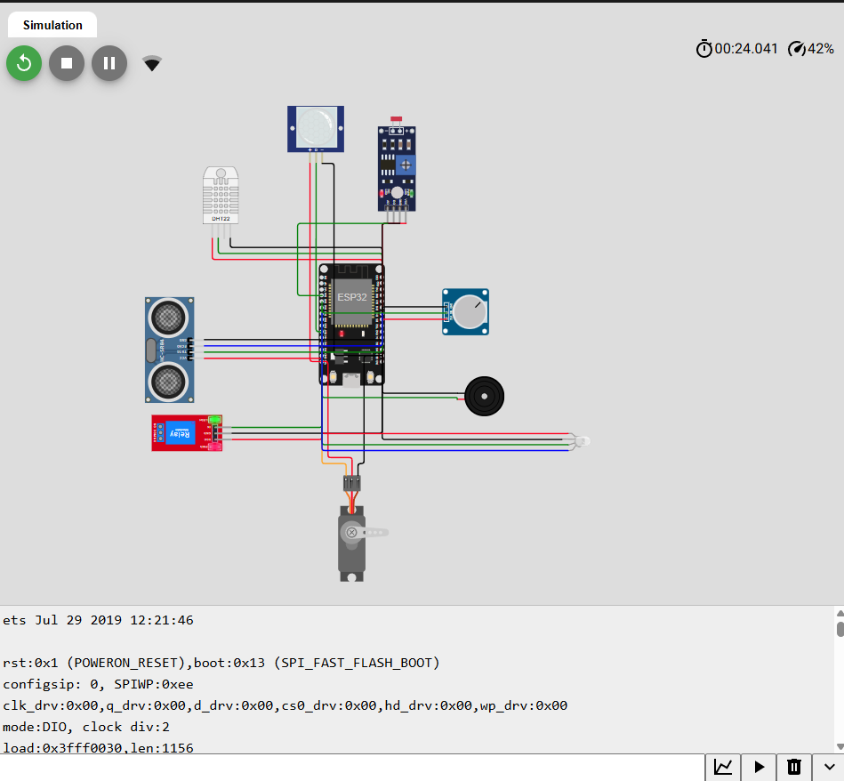 |
| Flujo de Node-RED: backend | 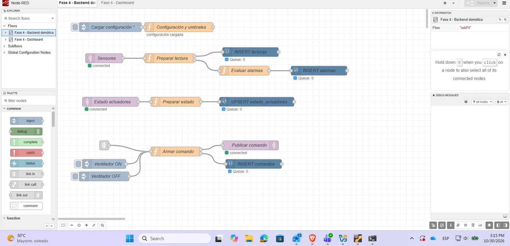 |
| Flujo de Node-RED: dashboard | 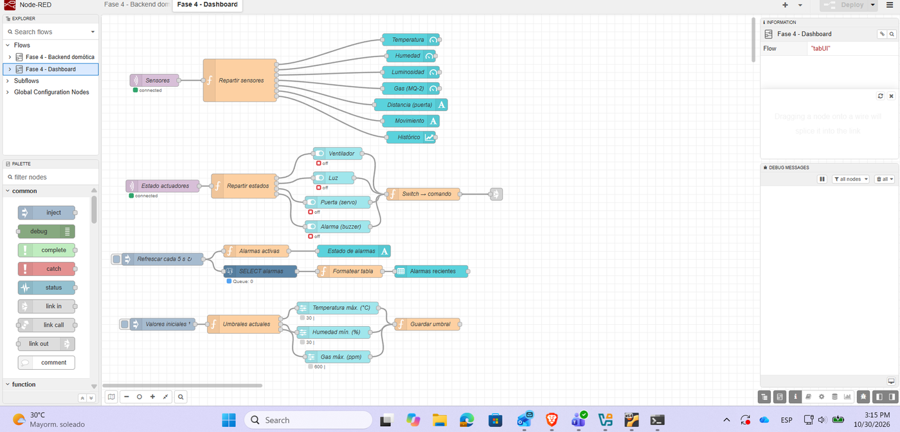 |
| Dashboard: sensores, control y alarmas | 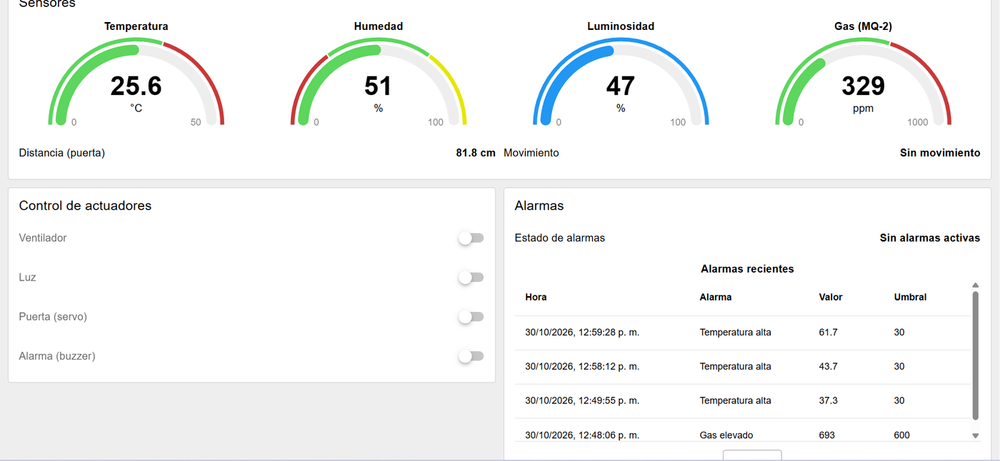 |
| Dashboard: histórico y umbrales | 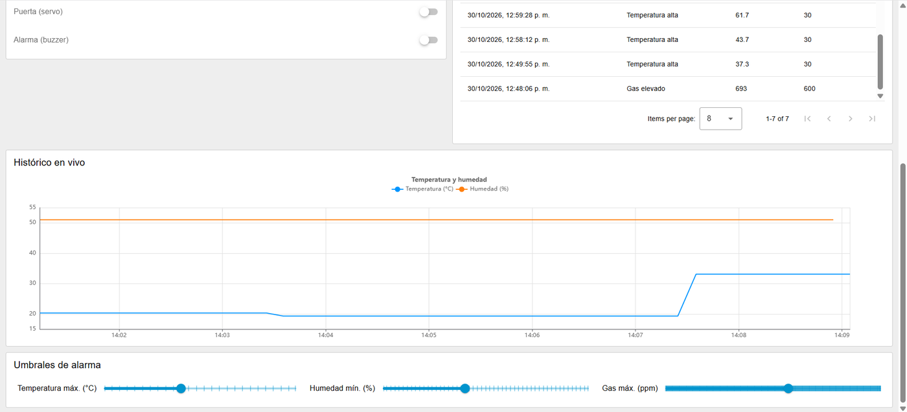 |
| Alarma de temperatura con el ventilador encendido | 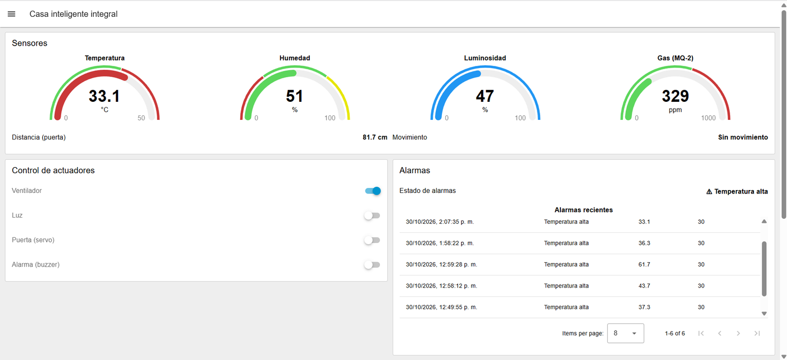 |
| Umbral ajustado a 20 °C | 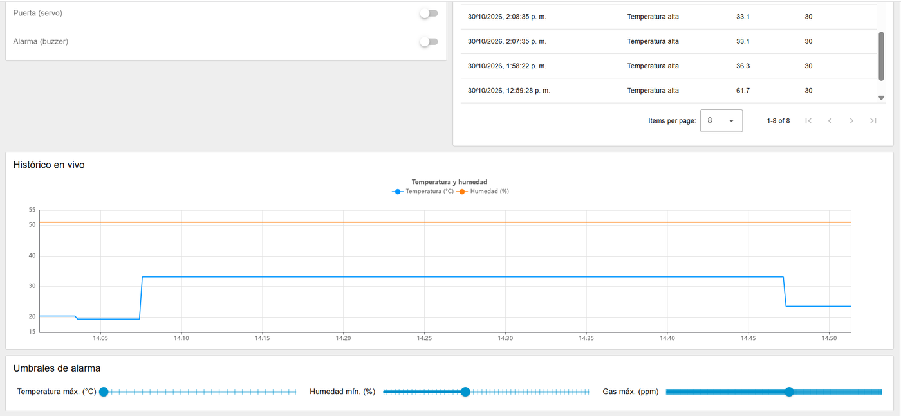 |
| Alarma de gas | 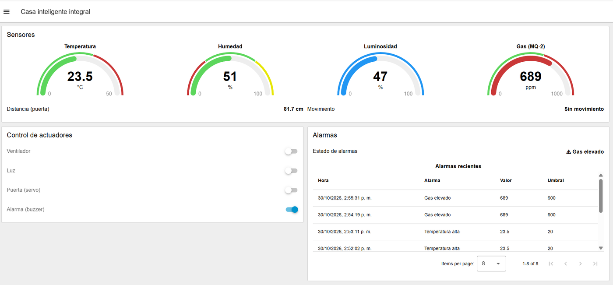 |
| Grafana: origen de datos | 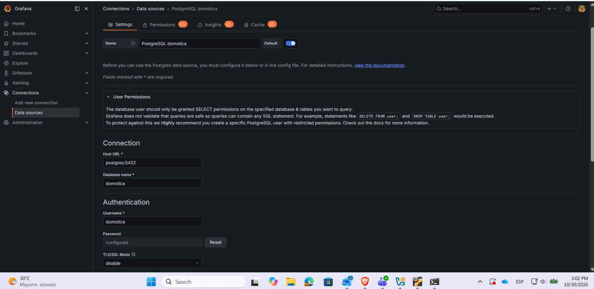 |
| Grafana: histórico | 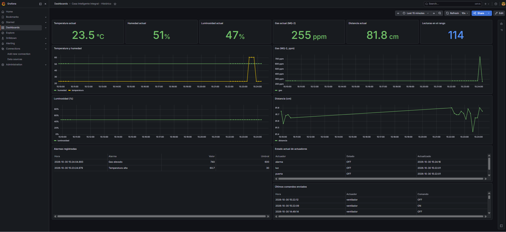 |

## Limitaciones y mejoras futuras

**Limitaciones**

- El broker público no tiene autenticación ni cifrado: cualquier persona que conozca el prefijo de topics podría leer o publicar mensajes.
- Todo el sistema es una **simulación**: no hay hardware físico; el MQ-2 se emula con un potenciómetro y el ventilador se representa con un relé.
- Los umbrales de alarma se guardan en memoria de Node-RED y vuelven a sus valores iniciales al reiniciarlo.
- El usuario de Grafana para PostgreSQL tiene permisos completos; lo recomendable es un usuario de solo lectura.
- El gráfico del dashboard de Node-RED es en vivo; el histórico completo está en Grafana.
- El servidor es una máquina virtual con recursos limitados (≈2 GB de RAM).

**Mejoras futuras**

- Broker propio (por ejemplo Mosquitto) en el servidor, con usuarios, ACL y TLS (puerto 8883).
- Persistir los umbrales en la base de datos.
- Notificaciones (correo o mensajería) ante alarmas.
- Pasar a hardware real (ESP32 y sensores físicos).
- HTTPS en el dashboard mediante proxy inverso (Nginx).
- Respaldos automáticos de la base de datos.

## Seguridad

- No se publican contraseñas: `server/.env` está en `.gitignore`; solo se incluye `.env.example`.
- El prefijo real de topics no se sube al repositorio; se usa el marcador `PREFIJO_EQUIPO`.
- Las credenciales de PostgreSQL se configuran en Node-RED y no forman parte de `flows.json`.

---
Proyecto académico — Universidad Don Bosco, El Salvador.
